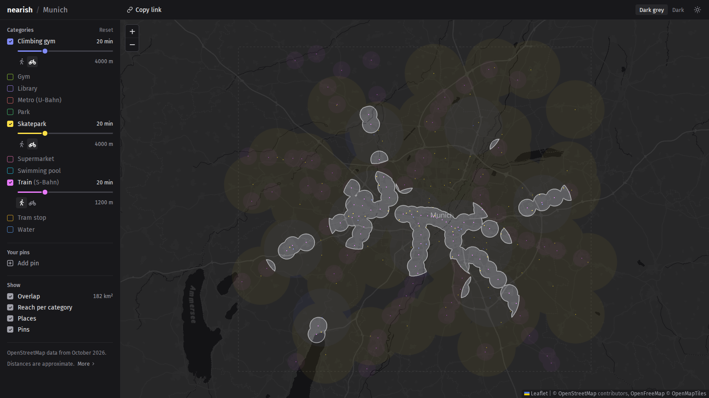

# nearish

An interactive map that shows where several kinds of places are all within reach, for example within a 15-minute walk of a skatepark and a 10-minute walk of a train station. Static site, built on [OpenStreetMap](https://www.openstreetmap.org/) data, with no backend or external services besides the [OpenFreeMap](https://openfreemap.org) tiles.

**[aisus.github.io/nearish](https://aisus.github.io/nearish/)**



*Munich: within 20 minutes by bike of a skatepark and of a climbing gym, and 20-minute walk of an S-Bahn station.*

## How it works

The [glossary](docs/glossary.md) defines the project's terms.

A visitor ticks categories (metro, park, etc.) and gives each a time budget: minutes and a mode, walk or bike.

Minutes × average speed × detour factor gives a radius, and a category's reach (the ground within that radius of any of its places). The overlap is the ground within reach of every ticked category.

The project is two halves that share only the static files in `public/data/`:

- **The fetch step** (`src/fetch/`, Node) builds those files. [`categories.yaml`](categories.yaml) holds a query for each category. Each file in [`regions/`](regions/) sets a region bbox, the categories it uses and any query that differs locally. A developer runs the step on their machine against [Overpass](https://overpass-api.de/) and commits the output. Adding a region or a category is a yaml file change and a fetch.
- **The page** (`src/`, Vue 3 and TypeScript on Leaflet) draws the map. Each reach is filled into a canvas, and they are intersected by image compositing. The basemap, from [OpenFreeMap](https://openfreemap.org), is drawn by MapLibre and is the only external service in use. A visitor's settings stay in their browser. A shared link carries them after the `#`.

## Limitations

- **Reach is a circle.** There is no routing, only a straight-line approximation, so a reach crosses rivers and motorways as if they were not there.
- **Small parks and water are left out.** A [size cut](docs/data.md#areas-parks-water-and-the-sea) keeps very small green zones and industrial basins off the map.
- **The data comes only from OpenStreetMap.** A place that is not mapped there is not mapped here.
- **Reach stops at the region's edge.** A place just outside the region does not count.
- **The overlap is drawn, not computed as a polygon.** In current form, polygon intersection is ruled out for better performance. There is no shape to export the overlap, and its size is an estimate.

## Running it

Requires [Node](https://nodejs.org/) 22.13 or newer. The data is committed, so no fetch is needed to start it locally.

```bash
npm install
npm run dev     # http://localhost:5173
npm run build   # the static site, in dist/
```

## Documentation

- [`CONTRIBUTING.md`](CONTRIBUTING.md): setup, commands, conventions and pull request requirements
- [`docs/architecture.md`](docs/architecture.md): how the code is structured
- [`docs/data.md`](docs/data.md): categories, regions and how queries are checked
- [`docs/design.md`](docs/design.md): how the page behaves, and why
- [`docs/glossary.md`](docs/glossary.md): the terms used on the page, in the docs and in the code

## Contributing

Pull requests are welcome. Bug reports and requests for a new region or category go in the [issue templates](https://github.com/aisus/nearish/issues/new/choose). This is a hobby project, so everything comes on a best-effort basis.

## How it was made

The app was built as a personal hobby project with Claude Code, which wrote most of the code and the docs. The architecture and design decisions, checks and testing, as well as a reasonable amount of cleanup, are the author's.  

## Licence

The code is MIT; see [`LICENSE`](LICENSE). The data in [`public/data/`](public/data/) is derived from OpenStreetMap, © OpenStreetMap contributors, and is available under the [Open Database License](https://opendatacommons.org/licenses/odbl/1-0/); see [its licence note](public/data/LICENSE.md).
